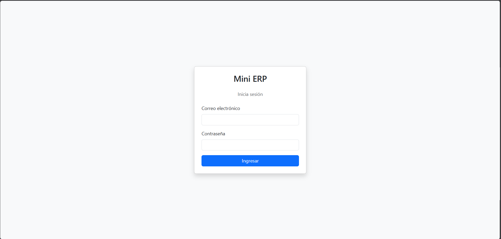
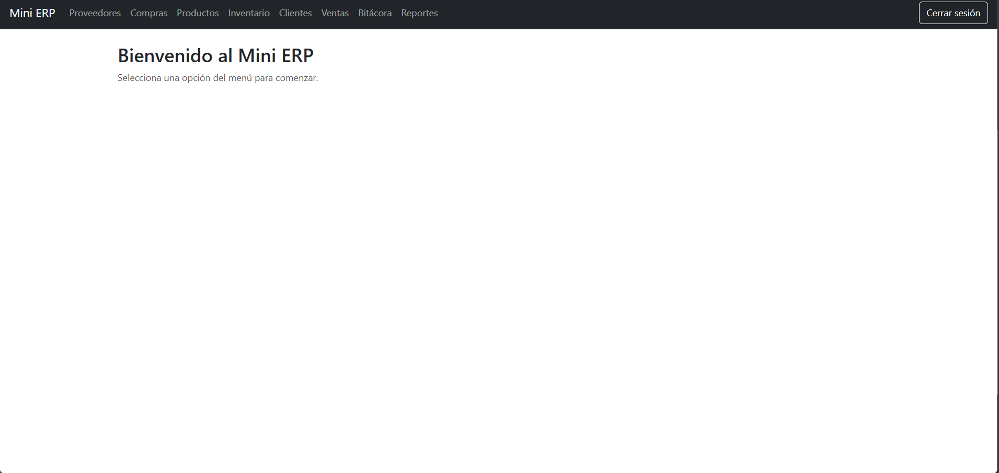
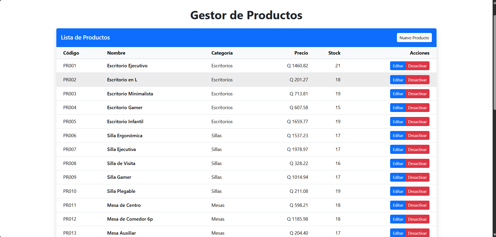
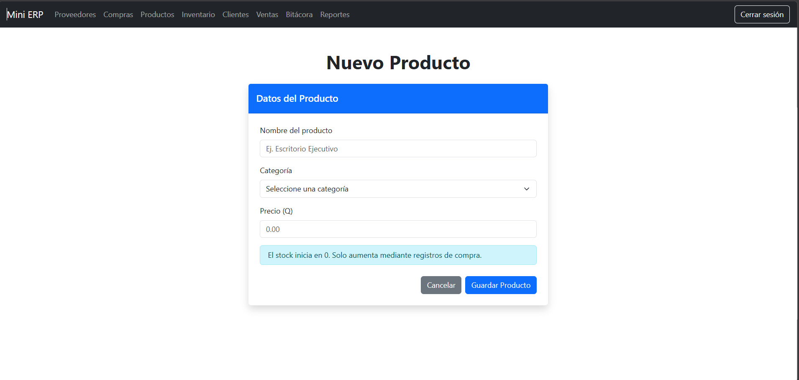
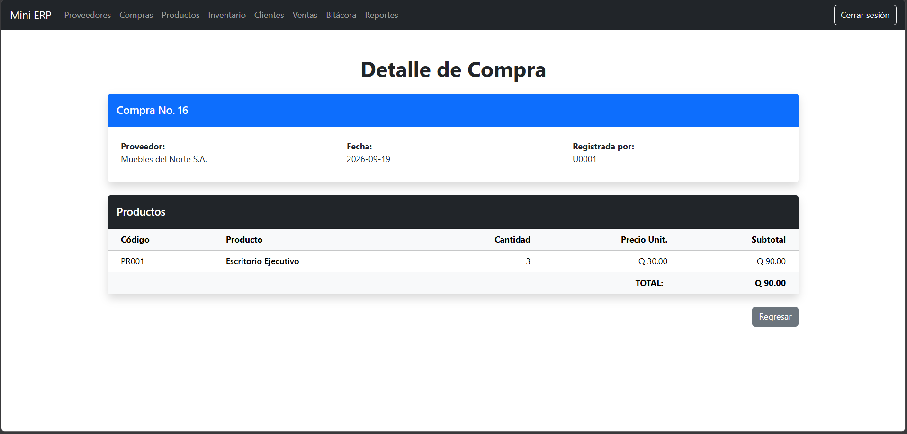
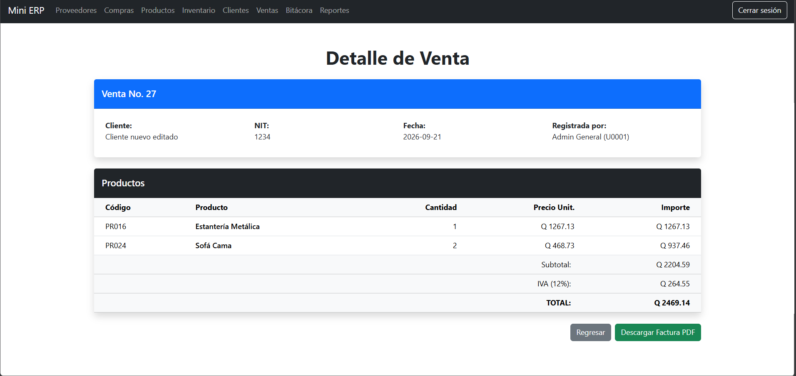
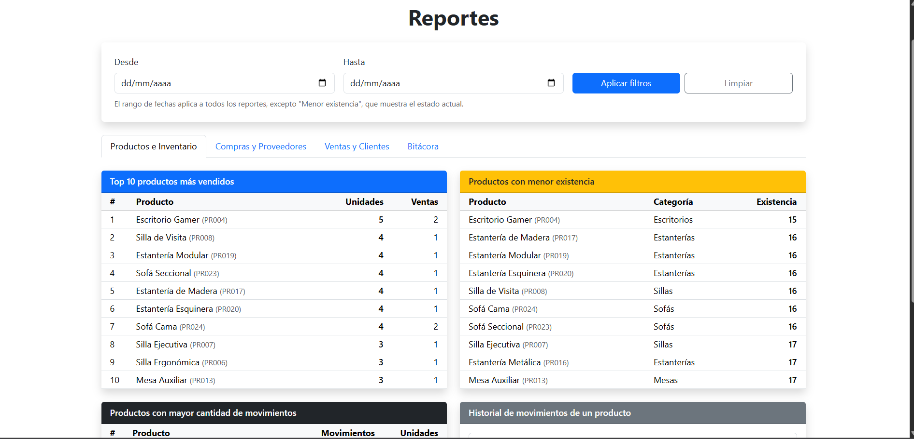
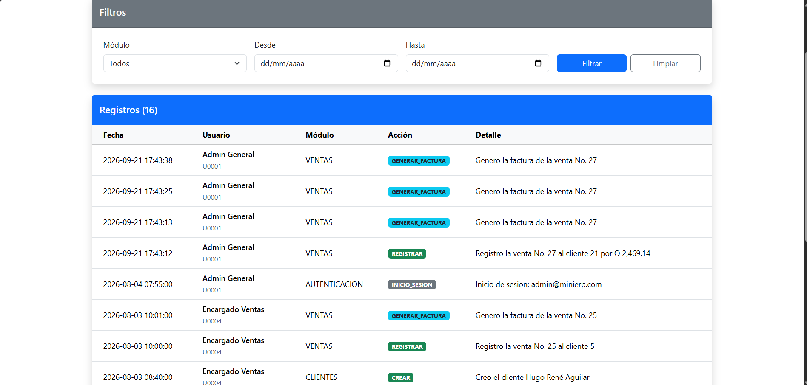

# Manual de Usuario — Mini ERP

**Universidad de San Carlos de Guatemala**
Centro Universitario de Occidente
División Ciencias de la Ingeniería — Ingeniería en Ciencias y Sistemas
Curso: Manejo e Implementación de Archivos

---

## Índice

1. [¿Qué es el Mini ERP?](#1-qué-es-el-mini-erp)
2. [Antes de empezar](#2-antes-de-empezar)
3. [Iniciar sesión](#3-iniciar-sesión)
4. [Pantalla principal y menú](#4-pantalla-principal-y-menú)
5. [Áreas y permisos](#5-áreas-y-permisos)
6. [Módulo de Productos](#6-módulo-de-productos)
7. [Módulo de Proveedores](#7-módulo-de-proveedores)
8. [Módulo de Clientes](#8-módulo-de-clientes)
9. [Módulo de Compras](#9-módulo-de-compras)
10. [Módulo de Ventas](#10-módulo-de-ventas)
11. [Facturas en PDF](#11-facturas-en-pdf)
12. [Módulo de Inventario](#12-módulo-de-inventario)
13. [Módulo de Reportes](#13-módulo-de-reportes)
14. [Bitácora del sistema](#14-bitácora-del-sistema)
15. [Cerrar sesión](#15-cerrar-sesión)
16. [Preguntas frecuentes](#16-preguntas-frecuentes)
17. [Mensajes del sistema](#17-mensajes-del-sistema)

---

## 1. ¿Qué es el Mini ERP?

El Mini ERP es un sistema de gestión comercial para una empresa dedicada a la
venta y distribución de muebles para hogar y oficina. Permite administrar desde
un solo lugar:

- El **catálogo de productos** y sus existencias
- Los **proveedores** y las **compras** que se les realizan
- Los **clientes** y las **ventas** que se les efectúan
- El **inventario**, con el historial de todo lo que entra y sale
- **Reportes** para analizar el comportamiento del negocio
- Una **bitácora** con las acciones realizadas por cada empleado

Lo más importante que hace el sistema por usted es **mantener todo
sincronizado**: cuando se registra una compra, las existencias suben
automáticamente; cuando se registra una venta, bajan. No hay que actualizar el
inventario a mano.

---

## 2. Antes de empezar

### Qué necesita

- Una computadora con conexión a la red donde está instalado el sistema
- Un navegador web (Chrome, Edge o Firefox)
- Su correo y contraseña, proporcionados por el área de Administración

### Cómo acceder

Abra el navegador y escriba la dirección del sistema:

```
http://localhost:4200
```

> **Nota:** esta dirección corresponde a una instalación local. Si el sistema
> está instalado en un servidor de la empresa, use la dirección que le haya
> indicado el área de Administración.

---

## 3. Iniciar sesión

Al entrar al sistema, lo primero que verá es la pantalla de acceso.



### Pasos

1. Escriba su **correo electrónico**.
2. Escriba su **contraseña**.
3. Presione **Ingresar**.

Si los datos son correctos, entrará a la pantalla de bienvenida. Si no, verá el
mensaje **"Credenciales incorrectas"**.

### Usuarios del sistema

Cada área cuenta con su propio usuario:

| Área | Correo |
|---|---|
| Administración | admin@minierp.com |
| Compras | compras@minierp.com |
| Inventario | inventario@minierp.com |
| Ventas | ventas@minierp.com |

> **Importante:** su contraseña es personal. Todo lo que se haga con su usuario
> queda registrado en la bitácora del sistema a su nombre.

---

## 4. Pantalla principal y menú

Después de iniciar sesión verá la pantalla de bienvenida con la barra de menú
en la parte superior:



> La imagen corresponde a un usuario del área de **Administración**, que tiene
> acceso a todos los módulos. Los demás usuarios verán menos opciones.

Las opciones del menú **cambian según su área**: cada usuario ve únicamente los
módulos que le corresponden. Si una opción no aparece en su menú, es porque su
área no tiene acceso a ella.

Para regresar a esta pantalla en cualquier momento, haga clic en **"Mini ERP"**,
a la izquierda del menú.

---

## 5. Áreas y permisos

| Área | Módulos disponibles |
|---|---|
| **Administración** | Todos los módulos, incluidos Reportes y Bitácora |
| **Compras** | Proveedores, Compras |
| **Inventario** | Productos, Inventario |
| **Ventas** | Clientes, Ventas |

---

## 6. Módulo de Productos

**Disponible para:** Inventario y Administración

Aquí se administra el catálogo de productos que comercializa la empresa.

### Ver el listado

Haga clic en **Productos** en el menú. Verá dos tablas:

- **Lista de Productos**: los productos activos, con su código, nombre,
  categoría, precio y existencia actual.
- **Productos Desactivados**: los que se dieron de baja. Se conservan para
  mantener el historial de compras y ventas.



### Crear un producto nuevo



1. Presione **Nuevo Producto**.
2. Complete los datos:
   - **Nombre del producto** (obligatorio)
   - **Categoría** (obligatorio, se elige de la lista)
   - **Precio** en quetzales (obligatorio)
3. Presione **Guardar Producto**.

> **El código se genera solo.** No debe escribirlo: el sistema asigna el
> siguiente disponible (PR031, PR032, y así sucesivamente).

> **La existencia inicia en 0.** No es un error. Las existencias solo aumentan
> registrando una compra, para que toda variación quede respaldada por un
> movimiento.

### Editar un producto

1. Presione **Editar** en la fila del producto.
2. Modifique el nombre, la categoría o el precio.
3. Presione **Guardar Cambios**.

El **código** y la **existencia** aparecen en gris porque no se pueden
modificar: el código identifica al producto de forma permanente, y la existencia
solo cambia mediante compras y ventas.

### Desactivar un producto

1. Presione **Desactivar** en la fila del producto.
2. Confirme en el mensaje que aparece.

El producto desaparece del catálogo y pasa a la tabla de desactivados. **No se
elimina**: todas las compras y ventas donde aparece siguen intactas.

---

## 7. Módulo de Proveedores

**Disponible para:** Compras y Administración

Funciona igual que Productos, con los campos:

- **Nombre del proveedor** (obligatorio)
- **Ubicación** (opcional)

El código se genera automáticamente con formato PV001, PV002, etc.

Un proveedor desactivado ya no aparece al registrar compras nuevas, pero su
historial de compras anteriores se conserva.

---

## 8. Módulo de Clientes

**Disponible para:** Ventas y Administración

Mismo funcionamiento, con los campos:

- **Nombre completo** (obligatorio)
- **NIT** (obligatorio)

> **El NIT no puede repetirse.** Si intenta registrar un cliente con un NIT que
> ya existe, el sistema mostrará: *"Ya existe un cliente registrado con ese NIT"*.

El **saldo** aparece en gris porque se administra automáticamente.

---

## 9. Módulo de Compras

**Disponible para:** Compras y Administración

Registra las compras a proveedores. **Cada compra aumenta las existencias
automáticamente.**

### Ver el historial

Haga clic en **Compras**. Verá todas las compras registradas, de la más
reciente a la más antigua, con su número, fecha, proveedor, quién la registró
y el total.

Para ver qué productos incluyó una compra, presione **Ver detalle**.



### Registrar una compra nueva

Una compra se arma en tres pasos: elegir el proveedor, agregar los productos y
guardar.

**Paso 1 — Seleccionar el proveedor**

En la sección *Datos de la Compra*, elija el proveedor de la lista.

**Paso 2 — Agregar los productos**

En la sección *Agregar Productos*:

1. Elija el **producto**.
2. Escriba la **cantidad**.
3. Escriba el **precio unitario** al que se lo vende el proveedor.
4. Presione **Agregar**.

El producto aparecerá en la tabla *Detalle de la Compra*, con su subtotal
calculado. Repita para cada producto de la compra.

```
┌────────────────────────────────────────────────────────────────────────┐
│ Detalle de la Compra                                                   │
├────────┬──────────────────────┬──────────┬─────────────┬──────────┬────┤
│ Código │ Producto             │ Cantidad │ Precio Unit.│ Subtotal │    │
├────────┼──────────────────────┼──────────┼─────────────┼──────────┼────┤
│ PR001  │ Escritorio Ejecutivo │    10    │   Q949.53   │ Q9,495.30│Quitar│
│ PR005  │ Escritorio Infantil  │     5    │   Q320.15   │ Q1,600.75│Quitar│
├────────┴──────────────────────┴──────────┴─────────────┼──────────┼────┤
│                                                 TOTAL: │Q11,096.05│    │
└────────────────────────────────────────────────────────┴──────────┴────┘
```

> Si se equivocó en una línea, presione **Quitar** y agréguela de nuevo.
> Mientras no presione *Registrar Compra*, nada se ha guardado.

**Paso 3 — Guardar**

Presione **Registrar Compra**. El sistema guardará la compra y **sumará las
cantidades a las existencias** de cada producto.

### Reglas del módulo

- No se puede registrar una compra sin proveedor.
- No se puede registrar una compra sin al menos un producto.
- Las cantidades deben ser mayores a cero.
- **Un producto no puede agregarse dos veces** en la misma compra. Si necesita
  más unidades, quite la línea y agréguela con la cantidad correcta.
- **Las compras no se pueden editar ni eliminar.** El historial comercial debe
  conservarse tal como ocurrió.

---

## 10. Módulo de Ventas

**Disponible para:** Ventas y Administración

Registra las ventas a clientes. **Cada venta descuenta las existencias
automáticamente** y genera su factura.

### Ver el historial

Haga clic en **Ventas**. Verá todas las ventas con su número, fecha, cliente,
NIT, vendedor, subtotal, IVA y total.

Cada fila tiene dos botones: **Ver detalle** y **Factura PDF**.



En el detalle se muestra el cliente, su NIT, la fecha, el empleado que registró
la venta, los productos vendidos y el desglose de subtotal, IVA y total. Desde
aquí también puede descargarse la factura.

### Registrar una venta nueva

**Paso 1 — Seleccionar el cliente**

Elija el cliente de la lista. Aparecen con su nombre y NIT.

**Paso 2 — Agregar los productos**

Al elegir un producto, el sistema llena automáticamente:

- El **precio** de venta, tomado del catálogo
- La cantidad **disponible** en existencia

```
┌──────────────────────────────────────────────────────────────────────┐
│ Agregar Productos                                                    │
├──────────────────────┬───────────┬────────────┬──────────┬───────────┤
│ Producto             │  Precio   │ Disponible │ Cantidad │           │
├──────────────────────┼───────────┼────────────┼──────────┼───────────┤
│ PR001 - Escritorio…▾ │ Q1,461.00 │     18     │    3     │    [+]    │
└──────────────────────┴───────────┴────────────┴──────────┴───────────┘
```

Escriba la cantidad y presione **+**.

> Los productos **sin existencia aparecen deshabilitados** en la lista y no
> pueden seleccionarse.

**Paso 3 — Revisar los totales**

Conforme agrega productos, la tabla muestra el desglose:

```
                                          Subtotal:   Q4,383.00
                                          IVA (12%):    Q525.96
                                          TOTAL:      Q4,908.96
```

El IVA del 12% se calcula automáticamente.

**Paso 4 — Guardar**

Presione **Registrar Venta**. El sistema:

1. Verifica que haya existencias suficientes
2. Registra la venta
3. Descuenta las cantidades del inventario
4. **Descarga la factura en PDF automáticamente**

### Reglas del módulo

- **No se puede vender más de lo que hay en existencia.** Si lo intenta, verá:
  *"Existencia insuficiente de [producto]. Disponible: X, solicitado: Y"*.
- Un producto no puede agregarse dos veces en la misma venta.
- Las ventas no se pueden editar ni eliminar.

---

## 11. Facturas en PDF

Cada venta tiene su factura, disponible **en cualquier momento**.

### Cuándo se genera

- **Automáticamente**, al registrar una venta nueva
- **Cuando usted quiera**, desde el botón **Factura PDF** en el historial de
  ventas
- Desde la pantalla de detalle de una venta, con **Descargar Factura PDF**

Esto aplica a **cualquier venta**, sin importar su antigüedad.

### Contenido de la factura

```
        Mini ERP - Muebles para Hogar y Oficina
                  FACTURA No. 26
              Fecha: 2026-09-21 14:35

  Cliente:       Ana Lucía Pérez
  NIT:           1234567-8
  Atendido por:  Encargado Ventas (U0004)

  ┌────────┬────────────────────┬──────────┬────────────┬───────────┐
  │ Código │ Producto           │ Cantidad │ Precio Un. │  Importe  │
  ├────────┼────────────────────┼──────────┼────────────┼───────────┤
  │ PR001  │ Escritorio Ejecut. │    3     │ Q1,461.00  │ Q4,383.00 │
  └────────┴────────────────────┴──────────┴────────────┴───────────┘

                                     Subtotal:    Q4,383.00
                                     IVA (12%):     Q525.96
                                     TOTAL:       Q4,908.96

                    Gracias por su compra
```

Incluye siempre el **nombre del empleado que registró la venta**.

### Dónde se guarda el archivo

En la carpeta de descargas de su navegador, con el nombre
`factura_26.pdf` (el número corresponde al de la venta).

---

## 12. Módulo de Inventario

**Disponible para:** Inventario y Administración

Muestra el estado de las existencias y explica **por qué** cambiaron.

### Resumen

En la parte superior hay cuatro indicadores:

```
┌──────────────┬──────────────┬──────────────┬──────────────┐
│ Productos    │  Unidades    │  Stock bajo  │  Agotados    │
│  activos     │ en existencia│   (≤ 17)     │              │
│     30       │     512      │      8       │      0       │
└──────────────┴──────────────┴──────────────┴──────────────┘
```

### Existencias que requieren atención

Tabla destacada en amarillo con los productos cuya existencia está en el nivel
mínimo o por debajo. Es lo primero que conviene revisar cada día, para saber
qué hay que pedir a los proveedores.

Cada producto muestra su estado:

| Estado | Significado |
|---|---|
| **NORMAL** (verde) | Existencia suficiente |
| **BAJO** (amarillo) | Conviene reabastecer |
| **AGOTADO** (rojo) | Sin existencias; no se puede vender |

### Existencias actuales

Listado completo de productos activos, **ordenado de menor a mayor existencia**,
de modo que los más urgentes aparecen primero.

Cada fila tiene un botón **Ver movimientos** que muestra el historial de ese
producto en particular.

### Historial de movimientos

Registro de **todo** lo que ha entrado y salido:

```
┌────────────┬──────────────────┬─────────┬──────────┬───────────────┬──────────────────┬────────┐
│ Fecha      │ Producto         │  Tipo   │ Cantidad │ Origen        │ Proveedor/Cliente│Registró│
├────────────┼──────────────────┼─────────┼──────────┼───────────────┼──────────────────┼────────┤
│ 2026-09-21 │ Escritorio Ejec. │ SALIDA  │    -3    │ Venta No. 26  │ Ana Lucía Pérez  │ U0004  │
│ 2026-01-26 │ Escritorio Ejec. │ ENTRADA │   +20    │ Compra No. 1  │ Muebles del Norte│ U0002  │
└────────────┴──────────────────┴─────────┴──────────┴───────────────┴──────────────────┴────────┘
```

Cada movimiento indica **de dónde vino**: el número de compra o venta que lo
originó, con quién se hizo la operación y qué empleado la registró.

**Filtros disponibles:**

- **Producto**: ver el historial de uno específico
- **Tipo**: solo entradas, solo salidas, o ambas
- **Desde / Hasta**: un rango de fechas

Presione **Filtrar** para aplicarlos o **Limpiar** para volver a ver todo.

---

## 13. Módulo de Reportes

**Disponible para:** Administración

Concentra la información de análisis del negocio.

### Filtro de fechas

En la parte superior hay un filtro que **aplica a todos los reportes a la vez**:



Si no selecciona fechas, los reportes muestran **toda** la información
disponible.

> El reporte *"Productos con menor existencia"* no cambia con el filtro, porque
> siempre muestra la situación actual del inventario.

### Pestañas

**Productos e Inventario**

| Reporte | Qué muestra |
|---|---|
| Top 10 productos más vendidos | Los que más unidades han salido |
| Productos con menor existencia | Los 10 con menos unidades disponibles |
| Productos con mayor cantidad de movimientos | Los que más rotación tienen |
| Historial de movimientos de un producto | Entradas y salidas del producto que elija |

**Compras y Proveedores**

| Reporte | Qué muestra |
|---|---|
| Compras en el rango | Todas las compras del período, con su total |
| Top 5 proveedores | Los que representan mayor monto acumulado |
| Productos adquiridos con mayor frecuencia | Los que más veces se han comprado |

**Ventas y Clientes**

| Reporte | Qué muestra |
|---|---|
| Ventas en el rango | Todas las ventas del período, con su total |
| Top 10 clientes | Los que más han comprado en monto |
| Top 10 productos por ingresos | Los que más dinero han generado |
| Resumen de ventas por período | Totales agrupados por día, mes o año |

> El *Resumen de ventas* tiene su propio selector para cambiar la agrupación
> entre **día**, **mes** y **año**.

**Bitácora**

Enlace al registro de interacciones de los usuarios.

---

## 14. Bitácora del sistema

**Disponible para:** Administración

Registra las acciones realizadas por los empleados dentro del sistema.



Cada registro indica la fecha y hora exactas, el empleado que realizó la acción
(con su nombre y código), el módulo afectado, el tipo de acción y una
descripción de lo ocurrido.

### Acciones registradas

| Acción | Cuándo ocurre |
|---|---|
| **INICIO_SESION** | Un usuario entra al sistema |
| **CREAR** | Se crea un producto, proveedor o cliente |
| **ACTUALIZAR** | Se modifica un registro existente |
| **DESACTIVAR** | Se da de baja un registro |
| **REGISTRAR** | Se registra una compra o una venta |
| **GENERAR_FACTURA** | Se descarga una factura |

### Filtros

- **Módulo**: Autenticación, Productos, Proveedores, Clientes, Compras o Ventas
- **Desde / Hasta**: rango de fechas

---

## 15. Cerrar sesión

Presione **Cerrar sesión**, en el extremo derecho del menú.

> Se recomienda cerrar sesión siempre que termine de trabajar, especialmente en
> computadoras compartidas. Recuerde que todo lo que se haga con su usuario
> queda registrado a su nombre en la bitácora.

---

## 16. Preguntas frecuentes

**¿Por qué mi producto nuevo aparece con existencia 0?**
Porque las existencias solo aumentan registrando una compra. Así, toda variación
del inventario queda respaldada por un movimiento que indica de dónde vino.

**¿Por qué no puedo modificar la existencia de un producto directamente?**
Por la misma razón. Si pudiera cambiarse a mano, el inventario dejaría de
coincidir con el historial de compras y ventas. Para aumentar existencias,
registre una compra.

**Me equivoqué al registrar una venta. ¿Cómo la borro?**
Las ventas y compras no se pueden eliminar: el sistema debe conservar el
historial comercial tal como ocurrió. Comuníquelo al área de Administración
para que se registre el ajuste correspondiente.

**¿Por qué no veo la opción Reportes en mi menú?**
Porque esa opción es exclusiva del área de Administración. Cada usuario ve
únicamente los módulos que corresponden a su área.

**Desactivé un producto por error. ¿Se perdió?**
No. Aparece en la tabla *Productos Desactivados* al final de la pantalla, y todo
su historial sigue intacto. La reactivación debe solicitarse al área de
Administración.

**¿Puedo volver a descargar la factura de una venta antigua?**
Sí. Entre a **Ventas**, localice la venta y presione **Factura PDF**. Funciona
con cualquier venta, sin importar cuándo se hizo.

**¿Por qué un producto aparece deshabilitado al registrar una venta?**
Porque no tiene existencias disponibles. Debe registrarse una compra de ese
producto antes de poder venderlo.

**El sistema me sacó y me pide iniciar sesión otra vez.**
Su sesión expiró por seguridad (dura 24 horas). Vuelva a iniciar sesión
normalmente.

**¿Cómo cambio mi contraseña?**
El sistema no incluye una opción de cambio de contraseña. Solicítelo al área de
Administración.

---

## 17. Mensajes del sistema

| Mensaje | Significado | Qué hacer |
|---|---|---|
| Credenciales incorrectas | El correo o la contraseña no coinciden | Verifique los datos; revise mayúsculas |
| El nombre del producto es obligatorio | Falta completar un campo | Complete el campo y vuelva a guardar |
| Debe seleccionar una categoría | No se eligió categoría | Seleccione una de la lista |
| El precio debe ser un valor mayor o igual a cero | Se escribió un precio negativo | Corrija el precio |
| Ya existe un cliente registrado con ese NIT | El NIT está duplicado | Verifique si el cliente ya existe |
| Debe seleccionar un proveedor / cliente | Falta elegirlo antes de guardar | Selecciónelo de la lista |
| Debe agregar al menos un producto | La compra o venta está vacía | Agregue al menos un producto |
| Ese producto ya fue agregado | Se intentó repetir un producto | Quite la línea existente y agréguela con la cantidad correcta |
| La cantidad debe ser mayor a cero | Se escribió 0 o un número negativo | Corrija la cantidad |
| Existencia insuficiente de [producto]. Disponible: X, solicitado: Y | Se intenta vender más de lo disponible | Reduzca la cantidad o registre una compra |
| No se pudieron cargar los productos | El servidor no responde | Verifique su conexión; si persiste, avise a soporte |
| La fecha inicial no puede ser mayor que la fecha final | El rango está invertido | Corrija las fechas |

---

*Fin del manual de usuario.*
